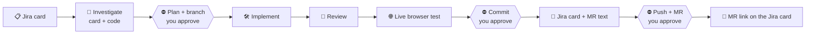

<div align="center">

# 🔄 sam-workflow

**Hand Claude Code a Jira card. Get back a tested, committed change and ready-to-paste Jira + MR text.**

An orchestrator skill plus four focused subagents that investigate, plan, implement, review, browser-test and close a ticket,
stopping for your approval exactly twice.


</div>

---

## ✨ How it works



You talk only to the **orchestrator** (`sam-task`). It does the investigation and planning itself, then delegates the rest:

| Phase | Who | What happens |
|---|---|---|
| 1-2 · Investigate | orchestrator | Reads the card, every comment and attachment in the browser, reproduces the bug, finds the real root cause in code |
| 3 · Plan ⛔ | orchestrator | Creates the branch, saves `.claude/plans/<KEY>.md`, **waits for your yes** |
| 4 · Implement | `sam-implementer` | Smallest change that fits the plan, runs type-check, lint and tests |
| 4b · Review | `sam-reviewer` | Read-only review of the diff against the plan, up to 2 fix loops |
| 5 · Live test | `sam-browser-tester` | Drives the real app: invariants, repeated interactions, narrow and desktop, then cleanup |
| 6-7 · Close ⛔ | `sam-closer` | Proposes a commit message, **waits for your yes**, commits, writes the Jira card, branch names, MR description and QA scenarios |
| 8 · Merge request ⛔ | orchestrator | On request: shows source → target, title and reviewers, **waits for your yes**, pushes, creates the GitLab MR (title, description, reviewers) and puts its link in the Jira card's merge-request field |

> It never pushes unless you ask, never types credentials, and never invents API shapes.

## 📦 What's inside

```
skills/
  sam-task/          the orchestrator   →  /sam-task PROJ-1234
  browser-test/      state-invariant browser testing (any browser MCP)
agents/              sam-implementer · sam-reviewer · sam-browser-tester · sam-closer
commands/            /jira  /implement  /review  /plan-min  /debug  /ctx
sam-models.conf.example   models, effort, browser and personal keys
sam-models-sync.py        applies the conf to the agents' frontmatter
update.sh                 pull + install into ~/.claude
```

## 🚀 Install

```bash
git clone https://github.com/Pooyamilani/sam-workflow.git
cd sam-workflow
bash update.sh
```

`update.sh` copies everything into `~/.claude`, creates your `sam-models.conf` from the example, and applies it.
Anything it replaces is backed up first to `~/.claude/.sam-workflow-backups/<timestamp>/`. Your own skills are never deleted.

**Update later:** run `bash update.sh` again, it does a `git pull` first.

## ⚙️ Configure

Edit `~/.claude/sam-models.conf` (created once, never overwritten), then run `~/.claude/sam-models-sync.py`.

| Setting | Example | Meaning |
|---|---|---|
| `orchestrator`, `implementer`, `reviewer`, `browser-tester`, `closer` | `sonnet  medium` | model + effort per role |
| `browser` | `builtin` | `auto` · `builtin` · `chrome` · `playwright` · `devtools` |
| `jira`, `gitlab` | `mcp` | `browser` (default) or `mcp`: how the skill reads cards and MRs |
| `ticket_prefix` | `PROJ` | prefix used for placeholder ticket numbers |
| `jira_url` | `https://jira.example.com/browse` | lets you pass just a key |
| `card_language` | `English` | language of the `/jira` output |
| `gitlab_project`, `mr_reviewers`, `mr_target`, `jira_mr_field` | `group/project`, `user1,user2`, `develop`, `Merge Request` | phase 8 (needs the GitLab MCP); all optional |

## 🔌 MCP access (optional)

Instead of driving Jira/GitLab through the browser, add their MCP servers once, then set `jira mcp` / `gitlab mcp` in `sam-models.conf`.
Keep tokens out of this repo: `claude mcp add` stores them in your own `~/.claude.json`.

```bash
# Jira (Server/DC): needs uv (https://astral.sh/uv) and a personal access token
claude mcp add jira -s user -e JIRA_URL=https://jira.example.com -e JIRA_PERSONAL_TOKEN=<PAT> -e JIRA_SSL_VERIFY=false -- uvx mcp-atlassian
# GitLab: HTTP, asks you to log in on first use
claude mcp add --transport http -s user gitlab-mcp https://gitlab.example.com/api/v4/mcp
```

Restart and open a new session; `gitlab-mcp` asks you to log in on first use.

## ✅ Requirements

- [Claude Code](https://claude.com/claude-code)
- One browser MCP (Claude desktop built-in, Claude in Chrome, Playwright, or chrome-devtools) for the Jira and testing phases
- A per-repo `.claude/skills/project/SKILL.md` describing your directories, validate commands, base branch and commit conventions. The workflow reads it first, and its rules win over the defaults
- `.claude/plans/` in your `.gitignore`

## 🔒 Keep private things private

This repo is deliberately generic. Company names, ticket prefixes, internal URLs and project skills belong in
`~/.claude/sam-models.conf`, in `~/.claude/skills/` or in each project's own `.claude/`, none of which `update.sh` touches.

## 🌍 Note on `/jira`

By default the card and QA scenarios are written in **Persian** using Jira wiki markup (RTL-friendly panels and tables).
Set `card_language` or edit `commands/jira.md` to change that.
